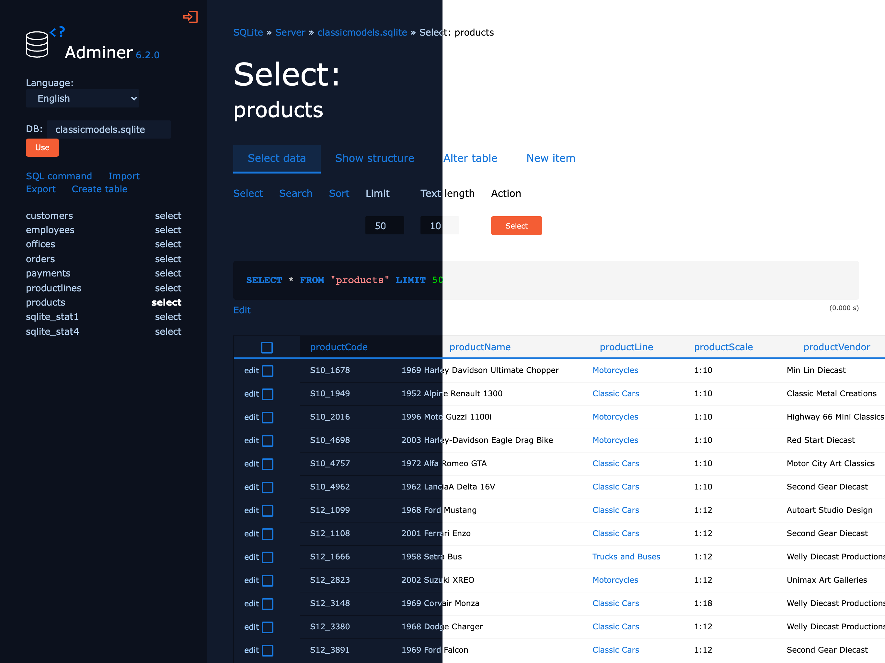

# Adminer theme


[](https://github.com/OverflowHayden/adminer-theme/blob/master/dist/adminer.css)


With light & dark mode toggled by OS preferences.



Made for Adminer 6.x.

## How to install
Just copy `dist/adminer.css` to the folder where `adminer.php` is located and you're done!

## Development
Requires Node.js and [pnpm](https://pnpm.io).

```sh
pnpm install
pnpm build   # compile src/adminer.scss to dist/adminer.css
pnpm watch   # rebuild on every change
pnpm lint    # run stylelint
```

To preview your changes, save Adminer as `index.php` in the repository root, symlink `adminer.css` to `dist/adminer.css` and run `php -S localhost:8000`.